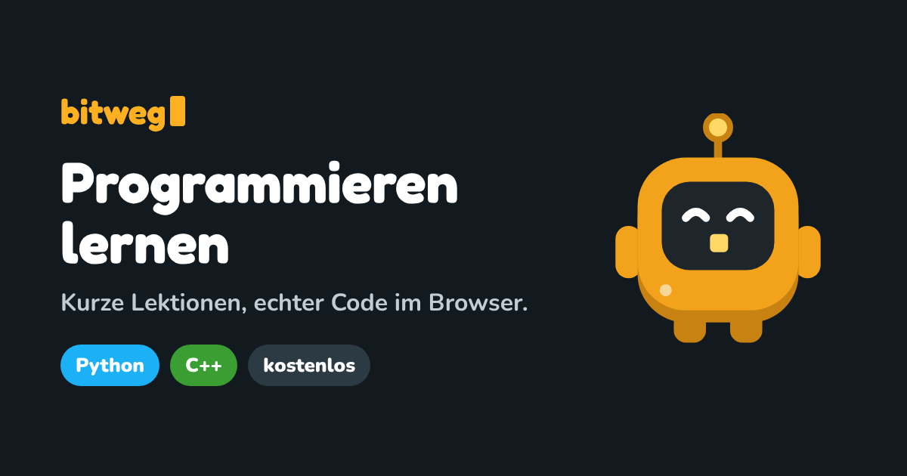

  

  <a href="https://bitweg.de/"><b>bitweg.de</b></a> ·
  <a href="https://bitweg.de/ueber.html">Über Bitweg</a> ·
  <a href="https://bitweg.de/datenschutz.html">Datenschutz</a> ·
  <a href="https://bitweg.de/impressum.html">Impressum</a>

<a href="#deutsch">Deutsch</a> · <a href="#english">English</a>

---

# Bitweg 🇩🇪

**Python und C++ lernen, Lektion für Lektion, im Stil einer Sprachlern-App.** Kurze Aufgaben, sofortiges Feedback, XP, Tages-Serien und Abzeichen. Der Code läuft echt im Browser, kostenlos, ohne Installation und ohne Werbung. Gemacht für Schüler, Schule und Informatikunterricht.

> Bitweg (mit **e**) ist nicht die Musiksoftware Bitwig.

## Was drin ist

| | |
|---|---|
| **Python** | 15 Abschnitte, 45 Lektionen: von `print()` über Schleifen, Listen und Funktionen bis zu Klassen, Rekursion, Algorithmen und kleinen Spielen |
| **C++** | 19 Abschnitte, 57 Lektionen: Grundlagen, Pointer, Speicher, Klassen, STL, RAII, Spielarchitektur, Raylib und Unreal-C++ |
| **Übungen** | Multiple Choice, Ausgabe vorhersagen, Lückentext, Zeilen ordnen, Code reparieren, Code selbst schreiben (wird echt ausgeführt und geprüft) |
| **Dazu** | Training mit immer neuen Aufgaben, Abschnittstests, Gold-Lektionen, 8 Projekte, 28 freie Aufgaben, Labor für eigene Programme |
| **Mit Konto** (freiwillig) | Fortschritt auf allen Geräten, Freunde, Chat mit Bildern und Dateien, Gruppen (z. B. eine Klasse), Rangliste. Login mit E-Mail oder Google |
| **Oberfläche** | Deutsch und Englisch, hell und dunkel, am Handy als App installierbar |

Alle Inhalte im Detail: [`LEHRPLAN.md`](LEHRPLAN.md).

## Zwei Versionen

| | Online ([bitweg.de](https://bitweg.de/)) | Auf dem eigenen PC |
|---|---|---|
| Starten | Link öffnen | `start.bat` doppelklicken |
| Python | läuft im Browser (Pyodide) | dein installiertes Python |
| C++ | Prüfung nach Regeln, kein Kompilieren | echter Compiler (g++ oder Visual Studio) |
| Konto, Freunde, Gruppen | ja | ja, gleiches Konto |

**PC-Version:** grüner Knopf **Code → Download ZIP**, entpacken, Python von python.org installieren (Haken bei „Add python.exe to PATH“), dann `start.bat`. Bitweg öffnet sich unter `http://127.0.0.1:5741`. Wie man C++ und VS Code einrichtet, steht in der App unter **Werkstatt**.

**Am Handy:** bitweg.de in Chrome öffnen, Menü (⋮) → **App installieren**. Python, Chat und Gruppen gehen auch dort, echtes C++ nur am PC.

## Für Lehrkräfte

- Keine Installation, ein aktueller Browser reicht. Ohne Konto bleibt der Fortschritt nur im Browser des Geräts.
- Auf geteilten Schul-PCs: Konto nutzen und nach der Stunde ausloggen.
- Eine Klassen-Gruppe hat Platz für bis zu 60 Mitglieder.
- Vor dem ersten Einsatz mit einer Klasse: [`EINRICHTEN.md`](EINRICHTEN.md), Abschnitt 12 (Anmelde-Limits, E-Mail, Ferien).

Mehr auf [bitweg.de/ueber.html](https://bitweg.de/ueber.html).

## Technik

- Statische Web-App aus HTML, CSS und JavaScript-Modulen, **kein Build-Schritt**. Hosting über GitHub Pages: Jeder Push auf `main` veröffentlicht den Ordner `app/`.
- Konten, Freunde, Chat und Gruppen über **Supabase** (PostgreSQL in Frankfurt). Wer was lesen und schreiben darf, prüft die Datenbank selbst (Row Level Security).
- Python im Browser über **Pyodide** (WebAssembly) in einem Web Worker.
- `server.py` ist ein kleiner lokaler Server nur für die PC-Version: liefert `app/` aus und führt Python und C++ auf dem PC aus (nur über `127.0.0.1` erreichbar).

| Datei | Inhalt |
|---|---|
| [`ANLEITUNG.md`](ANLEITUNG.md) | Bedienung, wie Code geprüft wird, Technik, Aufbau des Codes, neue Lektionen schreiben |
| [`LEHRPLAN.md`](LEHRPLAN.md) | Alle Abschnitte, Lektionen, Projekte und freie Aufgaben |
| [`EINRICHTEN.md`](EINRICHTEN.md) | Supabase einrichten (Konten, Chat, Gruppen, Google-Login), Einstellungen für eine Klasse |
| `supabase/*.sql` | Datenbank: Tabellen und Zugriffsregeln, in der Reihenfolge der Nummern ausführen |

## Datenschutz

Keine Werbung, keine Cookies, kein Tracking. Ohne Konto bleibt alles im Browser. Mit Konto speichert Supabase E-Mail (nur zum Einloggen), Profil, Lernstand, Freundschaften und Nachrichten. Nachrichten lesen nur Absender und Empfänger, eigene Nachrichten lassen sich löschen, das Konto jederzeit im Profil. Ausführlich: [bitweg.de/datenschutz.html](https://bitweg.de/datenschutz.html).

---

# Bitweg 🇬🇧

**Learn Python and C++, lesson by lesson, the way a language-learning app works.** Short exercises, instant feedback, XP, daily streaks and badges. Code really runs in the browser: free, nothing to install, no ads. Made for students, schools and computer science classes. The interface is available in German and English.

> Bitweg (with an **e**) is not the music software Bitwig.

## What's inside

| | |
|---|---|
| **Python** | 15 units, 45 lessons: from `print()` through loops, lists and functions to classes, recursion, algorithms and small games |
| **C++** | 19 units, 57 lessons: basics, pointers, memory, classes, STL, RAII, game architecture, Raylib and Unreal C++ |
| **Exercises** | Multiple choice, predict the output, fill the gaps, put lines in order, fix code, write code (really executed and checked) |
| **Also** | Practice with endless new tasks, unit tests, gold lessons, 8 projects, 28 open challenges, a lab for your own programs |
| **With an account** (optional) | Progress on every device, friends, chat with images and files, groups (e.g. a class), leaderboard. Sign in with email or Google |
| **Interface** | German and English, light and dark, installable as an app on phones |

## Two versions

| | Online ([bitweg.de](https://bitweg.de/)) | On your own PC |
|---|---|---|
| Start | open the link | double-click `start.bat` |
| Python | runs in the browser (Pyodide) | your installed Python |
| C++ | checked by rules, not compiled | real compiler (g++ or Visual Studio) |
| Account, friends, groups | yes | yes, same account |

**PC version:** green button **Code → Download ZIP**, unzip, install Python from python.org (tick "Add python.exe to PATH"), then run `start.bat`. Bitweg opens at `http://127.0.0.1:5741`. How to set up C++ and VS Code is explained in the app under **Workshop**.

## Tech

- Static web app made of HTML, CSS and JavaScript modules, **no build step**. Hosted on GitHub Pages: every push to `main` publishes the `app/` folder.
- Accounts, friends, chat and groups via **Supabase** (PostgreSQL in Frankfurt). Access rules are enforced by the database itself (Row Level Security).
- Python in the browser via **Pyodide** (WebAssembly) in a web worker.
- `server.py` is a small local server for the PC version only (reachable on `127.0.0.1` only).

The detailed docs ([`ANLEITUNG.md`](ANLEITUNG.md), [`LEHRPLAN.md`](LEHRPLAN.md), [`EINRICHTEN.md`](EINRICHTEN.md)) are in German.

## Privacy

No ads, no cookies, no tracking. Without an account everything stays in your browser. With an account, Supabase stores your email (for login only), profile, progress, friendships and messages. Messages can only be read by sender and recipient; you can delete your own messages and your whole account at any time. Details (German): [bitweg.de/datenschutz.html](https://bitweg.de/datenschutz.html).
